# Worklog design and delivery

## Outcome and scope

Maintain skim-friendly ticket/epic state and an append-only daily activity history across
cooperating Claude/Codex sessions on one machine. Standard-library Python; local filesystem;
Windows, macOS and Linux implementations, with platform evidence reported separately.
No cloud-sync or network-share concurrency guarantee, tracker integration, daemon or dashboard.
The private folder is user-configured, never an example/default path in the shared skill.

## Selected contract

Keep checkout, commit and append-daily with the specified 0/1/2/3/5/6 exit codes. A short
OS guard serializes filesystem operations only; agents edit unique private copies between calls.
Commit compares the current file hash with its checkout sidecar. On conflict, check out again
and redo the semantic change; never update the old copy's base.

Add begin/status and operation identity to track ticket, optional epic and daily completion.
Persist the daily content and captured date/time at begin. Each target update records its
operation identity in a script-owned receipt, allowing a retry after target replacement but
before journal completion to discover success. A resumed operation completes missing stages.
This is recoverable partial completion, not an atomic transaction across all files.

Replace each target using a same-directory temporary file, flush/fsync and atomic replace.
Daily content remains logically append-only but is physically replaced to avoid partial blocks.
Validate earlier dated history against the current file while its CAS base matches; header can
change, old sections cannot, and today's section only gains appended content. Preserve links
and unresolved questions through agent instructions; those semantic rules are not fully proved
by a history byte check.

## Alternatives

| Choice | Benefit | Limit | Decision |
| --- | --- | --- | --- |
| Original three commands only | Smallest API | Interrupted multi-file updates need manual reconstruction; retries can duplicate daily entries | Retain commands, add optional tracked flow |
| Short lock + CAS + recovery journal | Preserves concurrent edits and exposes/resumes partial completion | More metadata and receipts; still separate file commits | Selected |

Long-lived expiring locks and caller-supplied bases remain rejected. Do not add a distributed
transaction manager to satisfy a guarantee this local tool does not need to claim.

## Concurrent update sequence

```mermaid
sequenceDiagram
    participant A as Session A
    participant W as Worklog writer
    participant B as Session B
    A->>W: Checkout ticket at version V
    W-->>A: Unique copy and base V
    B->>W: Checkout ticket at version V
    W-->>B: Different copy and base V
    B->>W: Commit B copy
    Note over W: Short OS guard; compare V; replace file
    W-->>B: Success, version V2
    A->>W: Commit A copy based on V
    W-->>A: Exit 6, file is V2
    A->>W: Fresh checkout
    W-->>A: Copy containing B changes
    A->>W: Reapply A changes and commit
    W-->>A: Success with both changes
```

## Operation lifecycle

```mermaid
stateDiagram-v2
    [*] --> Pending: begin saves intent
    Pending --> TicketDone: guarded ticket commit
    TicketDone --> EpicDone: guarded epic rollup
    TicketDone --> DailyDone: no epic; append daily
    EpicDone --> DailyDone: append daily
    Pending --> DailyDone: BAU
    Pending --> Pending: conflict or interruption; status and fresh checkout
    TicketDone --> TicketDone: interruption; resume missing stages
    EpicDone --> EpicDone: interruption; resume daily
    DailyDone --> [*]
```



These diagrams express intended behaviour, not executed model checks. Receipt reconciliation
covers a target update that succeeded before its journal state was marked done.

## Delivery units and evidence

1. Shared Forge guidance and visuals: metadata/link checks and representative routing trials.
2. Worklog writer and documentation: subprocess tests for original CLI, encoding, names,
   matching, conflicts, wrong copies, OS lock release and negative-control lost updates.
3. Recovery/history: replay after interrupted stage completion, atomic daily failure controls,
   preserved earlier entries, bounded PermissionError retries and coherent operation identity.
4. Fresh independent Codex planner review (user approved replacing unavailable Opus); fix
   blockers and should-fixes, rerun affected checks and review the final candidate.
5. Install both hosts, verify source/install identity, configure the separate private folder.

Actual checks and platform limits belong in the progress log and final validation report.
Use Sonnet as the Claude skill runtime; invoke its model-changing skill at turn end.
Codex retains its configured model and uses an equivalent explicit UTF-8 file-write operation.
